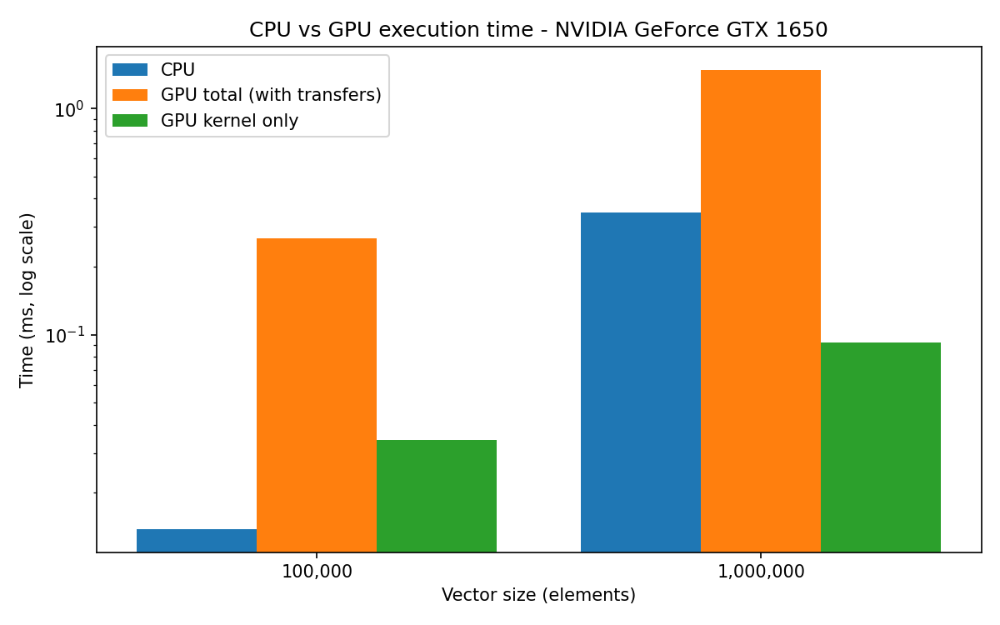
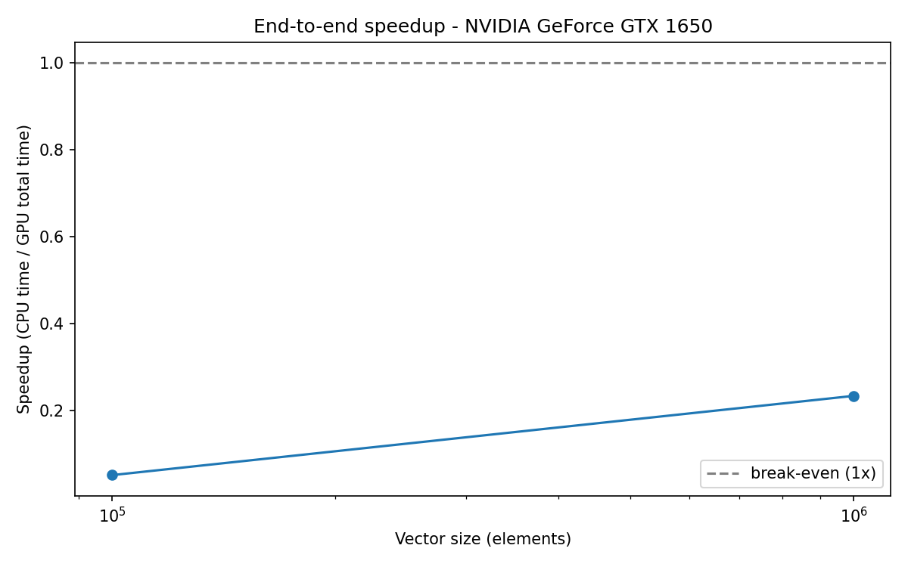
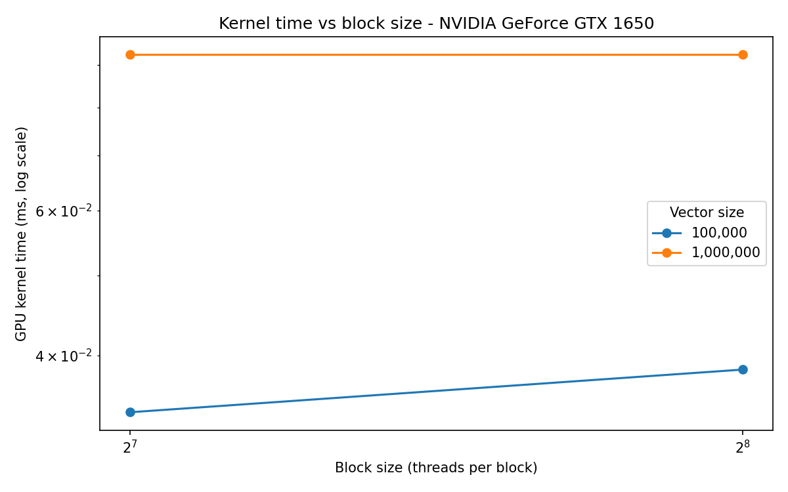
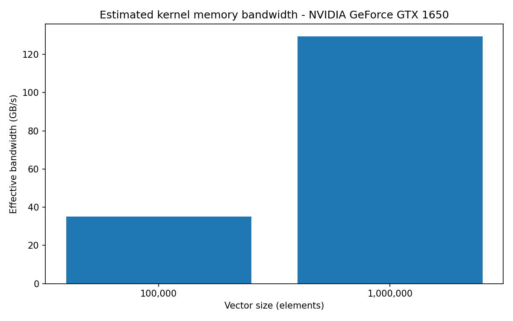

# Benchmark Results

**GPU:** NVIDIA GeForce GTX 1650  
**Validation:** ALL PASS

## Best block size per vector size

| Vector size | Best block | CPU (ms) | GPU kernel (ms) | GPU total (ms) | Speedup | Bandwidth (GB/s) |
|---:|---:|---:|---:|---:|---:|---:|
| 100,000 | 128 | 0.0138 | 0.0341 | 0.2665 | 0.05x | 35.1 |
| 1,000,000 | 128 | 0.3480 | 0.0927 | 1.4866 | 0.23x | 129.4 |

## Findings (computed from the data)

- **100,000 elements:** kernel alone is 0.4x vs CPU; with transfers it is 0.05x. CPU faster end-to-end (transfer cost dominates).
- **1,000,000 elements:** kernel alone is 3.8x vs CPU; with transfers it is 0.23x. CPU faster end-to-end (transfer cost dominates).

## Charts

### CPU vs GPU time

### Speedup by size

### Block size performance

### Memory bandwidth

